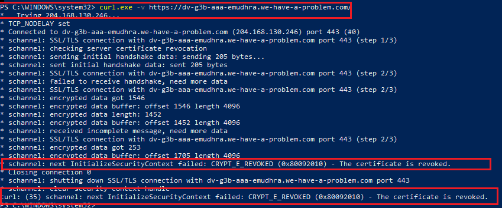
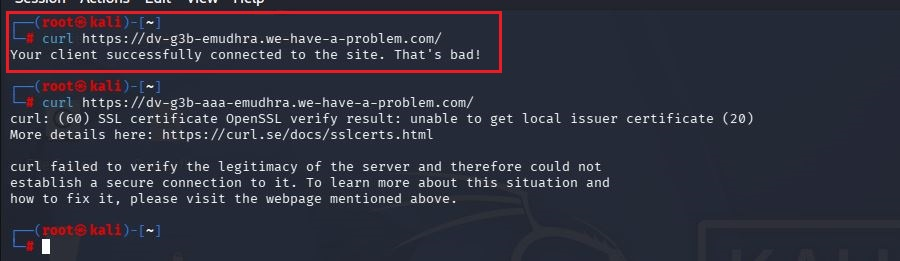
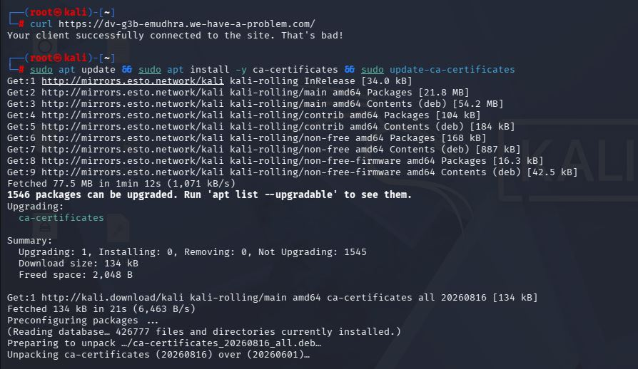
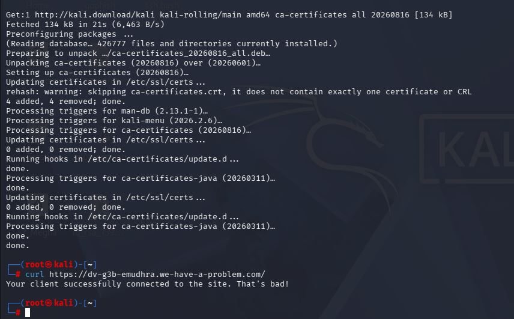

# eMudhra compromised CA — does your system still trust it?

A hands-on test that checks whether a Windows machine and a Kali Linux
machine on the same network both correctly block a compromised
security certificate — and what happened when we tried to fix the one
that didn't.

## 1. What actually happened (in plain terms)

Every website you visit over `https://` (the padlock in your browser)
proves its identity using a **certificate**, issued by a trusted
company called a **Certificate Authority (CA)**. Think of a CA as an
official stamp-maker: it gives websites a stamp of authenticity, and
your browser only trusts stamps that trace back to a short list of
approved stamp-makers.

In October 2026, security researchers found that **eMudhra**, one of
these trusted stamp-makers, had made a serious mistake. Eight of its
signing keys — the "master stamps" used to issue website
certificates — were generated with so little randomness that **anyone
could recompute the private key just by looking at the public
certificate**. No hacking or data theft was needed; the keys were
simply too weak to begin with.

This meant anyone who worked this out could forge a certificate for
**any website** and have browsers treat it as genuine. In response,
Chrome, Firefox, and other browser/OS vendors moved quickly to
**revoke trust** in the affected certificates, usually within hours of
being told.

**The real question this project asks:** did every device actually
receive and apply that revocation? A security fix only works if every
machine enforces it — so this test checks two machines in the same
home lab against a certificate signed by one of the compromised keys.

## 2. The test

A public site, `https://dv-g3b-emudhra.we-have-a-problem.com/`, is
deliberately served using a certificate signed by the compromised
`EM DV TLS CA - G3B` key, built specifically so anyone can check their
own system. If your system correctly blocks it, you're safe from this
particular issue. If it connects successfully, your system is still
trusting a certificate that should never be trusted again.

```bash
# Windows
curl.exe -v https://dv-g3b-emudhra.we-have-a-problem.com/

# Kali Linux
curl https://dv-g3b-emudhra.we-have-a-problem.com/
```

## 3. Step 1 — Checking Windows



Windows refused the connection outright, with the error
`CRYPT_E_REVOKED (0x80092010) - The certificate is revoked.` The log
also shows Windows actively checking certificate revocation during the
handshake (`checking server certificate revocation`). **Result:
Windows was protected.**

## 4. Step 2 — Checking Kali Linux



Kali's `curl` connected without any error, and the test site's own
response said it plainly:

> "Your client successfully connected to the site. That's bad!"

**Result: Kali was still trusting the compromised certificate.** Two
machines on the same network, two different outcomes — this is the
core finding of the test.

## 5. Step 3 — Trying to fix Kali with a normal update

The obvious next step was to update Kali's certificate store:

```bash
sudo apt update && sudo apt install -y ca-certificates
sudo update-ca-certificates
```



The update ran successfully and upgraded the `ca-certificates`
package from version `20260601` to `20260816`.

## 6. Step 4 — Re-testing after the update



After the update finished, the exact same test was run again — and
**the result was unchanged.** Kali still connected to the site
carrying the compromised certificate.

## 7. Why the update didn't help

This is the most important finding of the whole test. The
`ca-certificates` package on Linux only manages which **root**
CAs (the top-level stamp-makers) are trusted — it adds or removes
entire root CAs when the official list changes.

It does **not** track revocation of one specific **intermediate**
certificate from an otherwise-still-trusted CA, which is exactly
eMudhra's situation here. That kind of fine-grained revocation is
normally handled by the *browser itself* (Chrome's CRLSets, Firefox's
OneCRL) — not by the operating system's certificate bundle, and not by
command-line tools like `curl` that rely on the OS bundle.

**In short:** a fully updated OS package does not guarantee protection
against this kind of certificate compromise. Tools that depend on the
OS trust store — `curl`, many backend services, most CLI tools — can
stay exposed even when a browser on the very same machine would block
the same certificate outright.

## 8. Why this matters beyond this one test

This is a small, concrete example of a bigger security principle:
**different parts of the same environment patch at different speeds,
and an attacker only needs to find the one that's lagging.** A SOC
(Security Operations Center) exists precisely to catch this kind of
gap — by monitoring every endpoint, not assuming that "the system is
updated" means every component of it is protected.

## Files in this repo

| File | What it shows |
|---|---|
| `01-windows-blocked.png` | Windows rejecting the compromised certificate |
| `02-kali-first-test.JPG` | Kali connecting to the same certificate — unsafe |
| `03-kali-update-running.JPG` | Attempting to fix it with a standard certificate update |
| `04-kali-update-finished-retest.JPG` | Same unsafe result, even after the update |

## A note on a second URL tested

A second URL variant (`dv-g3b-aaa-emudhra.we-have-a-problem.com`,
with an extra "aaa") was also tried during testing and gave a
different error on Kali: `unable to get local issuer certificate`.
That error means curl couldn't even build the certificate chain — a
different problem from revocation — so it was not used as evidence
here. Only the plain `dv-g3b-emudhra...` result, shown above, is a
reliable signal of whether revocation is enforced.
